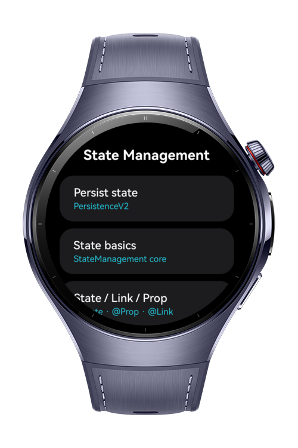
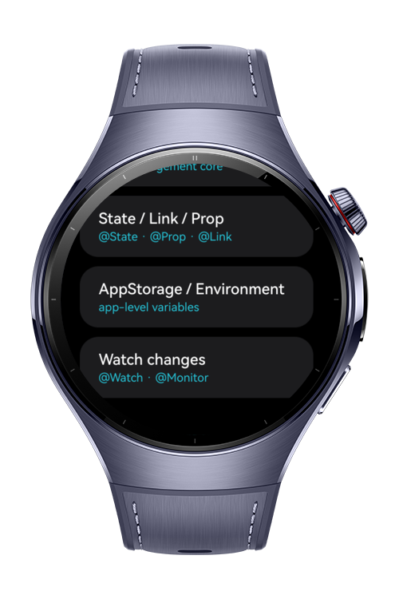
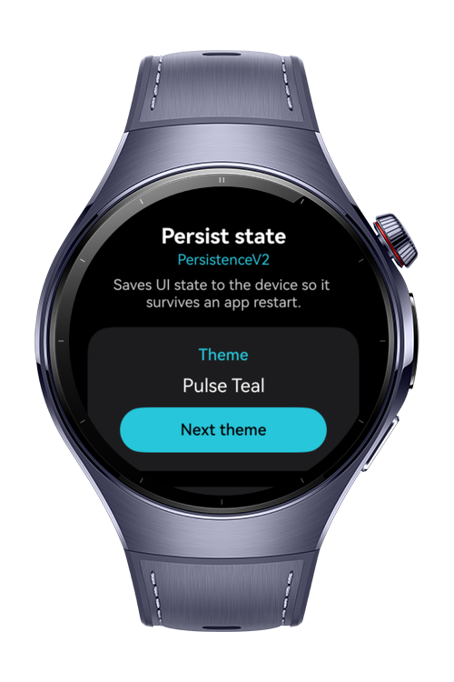
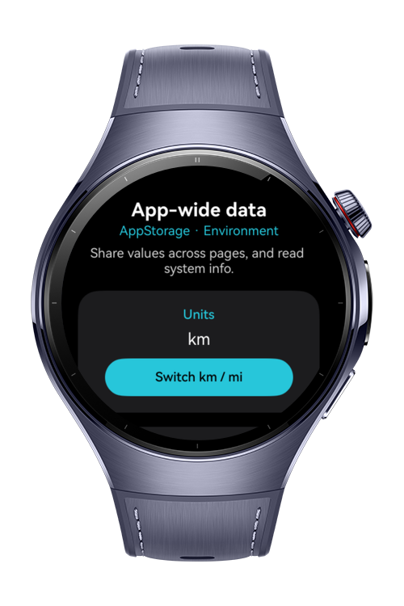

> **Note:** To access all shared projects, get information about environment setup, and view other guides, please visit [Explore-In-HMOS Index](https://github.com/Explore-In-HMOS/hmos-index).

# How To Build State Persistence

How To Build State Persistence is a HarmonyOS wearable app that demonstrates the full ArkUI state-management toolkit — `PersistenceV2` device-persisted state, the StateManagement core (`@State`), parent/child data flow with `@State`/`@Prop`/`@Link`, app-wide values via `AppStorage`/`Environment`, and reactive change handlers with `@Watch`/`@Monitor`.

The app is structured as a set of focused lessons reachable from a single home screen. Each lesson isolates one capability with a live, learner-driven demo: persisting display preferences (accent color, units, watch face) so they survive an app restart, observing how only state-dependent UI re-renders, sharing settings across pages, reading system environment info, and running code automatically when a tracked value changes.

# Preview

<div>
  
  
  
  
</div>

# Use Cases

- **Persisted display preferences**: Save accent color, distance units, and watch face to the device with `PersistenceV2` so they survive a full app restart.
- **Reset to defaults**: Clear persisted state with `remove()` and reconnect a fresh handle so defaults show immediately.
- **State basics**: Show how `@State` is observed and only dependent UI re-renders while static text stays unchanged.
- **Parent/child data flow**: Compare `@State`, `@Prop`, and `@Link` to see which child control writes back to the parent's value.
- **App-wide shared data**: Read and write shared settings across pages with `AppStorage` (`@StorageLink`/`@StorageProp`) and read system info via `Environment`.
- **Reactive change handlers**: Trigger logic automatically when a value changes using `@Watch` and `@Monitor`, e.g. a goal-milestone badge that reacts on its own.

# Technology

## Stack

- **Languages**: ArkTS / ArkUI
- **Frameworks**: HarmonyOS SDK 6.0.1(21)
- **Tools**: DevEco Studio 6.x+
- **Libraries**:
  - `@kit.ArkUI`

## Required Permissions

No permission required.

# Directory Structure

```
entry/src/main/ets/
|--- common/
|    |--- constants/
|    |    |--- AppKeys.ets
|    |    |--- LessonStyle.ets
|    |    |--- PageRoutes.ets
|    |--- util/
|    |    |--- AppNavigator.ets
|--- components/
|    |--- LabCard.ets
|    |--- LessonScaffold.ets
|    |--- LessonScaffoldV2.ets
|    |--- MonitorCard.ets
|    |--- SessionControl.ets
|    |--- StatTile.ets
|--- entryability/
|    |--- EntryAbility.ets
|--- model/
|    |--- DisplayPrefs.ets
|    |--- persistence.ets
|--- pages/
|    |--- Index.ets
|    |--- Home.ets
|    |--- Display.ets
|    |--- StateBasics.ets
|    |--- Workout.ets
|    |--- Settings.ets
|    |--- Insights.ets
|    |--- RouteBuilders.ets
```

# Constraints and Restrictions

## Supported Devices

- Huawei Watch 5
- DevEco Studio wearable simulator

# License

**How To Build State Persistence** is distributed under the terms of the MIT License.
See the [LICENSE](/LICENSE) for more information.
